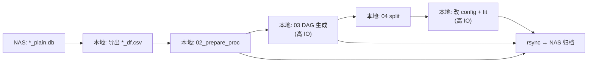

# 目标

使用 mzVault 高分辨 MS/MS 库训练 **FraGNNet**（结构 → 谱图预测）。

本仓库论文实验默认数据是 **NIST 2020**（`MSP` + `.MOL`）。我们的数据是 **Thermo mzVault HR1/HR2**，不能直接套官方 `01_prepare_df.py` 的 NIST20 命令，需要先做格式对齐。

# 存储与 IO 策略（重要）

当前代码与数据在 **NAS** 上，大量读写带宽约 **~200 MB/s**。DAG 生成、训练 DataLoader 等是高 IO 任务，**不要直接在 NAS 路径上跑**。做法对齐隔壁 **ms-pred**（见 `ms-pred/run_scripts/iceberg/nist23_hr/run_all.sh`）：

| 角色 | 路径 | 用途 |
|---|---|---|
| NAS 源 / 归档 | `/mnt/nas/data/YangLab_Personal/lirui/package/fragnnet` | 代码与结果长期保存 |
| NAS 原始库 | `/mnt/nas/data/YangLab_Personal/lirui/data/2026.10.08.NIST.MS.db` | 只读源数据 |
| 本地工作区（运算） | `/home/lirui/package/fragnnet` | 预处理、DAG、训练的实际 cwd |
| conda 环境 | `/mnt/nas/conda/envs/lirui_fragnnet_gpu` | 可继续用 NAS 上的 env（加载一次即可） |

原则：

1. **代码**：`rsync` NAS → 本地工作区（或 git clone / 软链策略二选一；推荐本地完整拷贝一份可跑的 tree）。
2. **重 IO 步骤**（导出后的 `data/df`、`data/proc`、`data/frag`、`data/split`、checkpoint、日志）：全部写在 **`/home/lirui/package/fragnnet`**。
3. **阶段性 / EXIT 时**把产物 `rsync` 回 NAS 归档；本地盘挂了可随时再 `rsync` 回来续跑。
4. **原始 `*_plain.db`**：体积大（各 ~1.3 GB）。一次性导出 CSV 可直接读 NAS；若导出本身很慢或要反复调试，再把 `*_plain.db` 拷到本地 `/home/lirui/data/...`。

参考脚手架（与 ms-pred 同风格）：

```bash
ROOT=/home/lirui/package/fragnnet
NAS=/mnt/nas/data/YangLab_Personal/lirui/package/fragnnet
NAS_DB=/mnt/nas/data/YangLab_Personal/lirui/data/2026.10.08.NIST.MS.db

# 首次：同步代码到本地（排除巨大/可再生数据亦可）
mkdir -p "$ROOT"
rsync -a --exclude '.git' --exclude 'wandb' --exclude 'data/frag' \
  --exclude 'data/proc' --exclude '__pycache__' \
  "$NAS/" "$ROOT/"

cd "$ROOT"
source /opt/miniforge3/etc/profile.d/conda.sh
conda activate lirui_fragnnet_gpu

copy_back() {
  mkdir -p "$NAS/data" "$NAS/wandb"
  rsync -a data/df/            "$NAS/data/df/"            2>/dev/null || true
  rsync -a data/proc/nist23/   "$NAS/data/proc/nist23/"
  rsync -a data/frag/          "$NAS/data/frag/"
  rsync -a data/split/         "$NAS/data/split/"
  rsync -a wandb/              "$NAS/wandb/"              2>/dev/null || true
  # checkpoint 目录按实际 config 调整
  echo "copied back to $NAS at $(date)"
}
trap copy_back EXIT

# ……在 $ROOT 下跑 Step 1–5……
# 每完成一大步可手动再调一次 copy_back
```

下文命令默认 **`cd $ROOT`（`/home/lirui/package/fragnnet`）** 后执行；相对路径 `data/...` 均指本地工作区。

# 数据源

```text
/mnt/nas/data/YangLab_Personal/lirui/data/2026.10.08.NIST.MS.db/
├── MSMS_HR1_plain.db / MSMS_HR2_plain.db   # 推荐：明文 SQLite，可直接读
├── MSMS_HR1.msp / MSMS_HR2.msp             # 有归属谱（但 Smiles 为空）
├── MSMS_HR1_unassigned.msp / ...          # 无归属谱：无结构，不能训
└── readme.md
```

## 规模（有归属谱）

| | HR1 | HR2 | 合计（约） |
|---|---:|---:|---:|
| 化合物 | 28,524 | 22,739 | ~49,590（去重后） |
| 有归属谱 | 900,039 | 784,239 | 1,684,278 |
| 无归属谱 | 138,798 | 50,758 | 不可用于结构→谱图训练 |

## 与论文过滤对齐后的可用量（估算）

过滤条件：`[M+H]+` + `MassAnalyzer=FT` + `FragmentationMode=HCD` + `Polarity=+`

| | 谱图数 | 唯一化合物（有 Structure） |
|---|---:|---:|
| HR1 | ~237,326 | ~19,485 |
| HR2 | ~224,467 | ~17,225 |

量级足够训练 FraGNNet。

# 关键差异：为什么不能直接用现有 MSP

| 项 | 我们的数据 | FraGNNet 管线预期 | 影响 |
|---|---|---|---|
| 结构 | MSP 中 `Smiles:` **全空**；DB 中几乎都有 `Structure`（MOL 文本），`SmilesDescription` 几乎全空 | 必须有可解析的 SMILES / MOL | **必须从 DB 的 Structure 导出 SMILES** |
| MSP 字段名 | `PrecursorMz`, `IonMode`, `InChiKey`, `Smiles` | `PrecursorMZ`, `Ion_mode`, `InChIKey`, `SMILES` | `01_prepare_df.py` 对不上 |
| 极性字符串 | MSP：`positive` / `negative` | `P`/`N` 或 `POSITIVE`/`NEGATIVE` | 否则 `ion_mode` 变 NaN |
| 仪器 / 碎裂 | DB 有 `MassAnalyzer` / `FragmentationMode`；MSP **未写出** | `inst_type`, `frag_mode` | 过滤与 CE 解析依赖这些字段 |
| 碰撞能 | 纯数字如 `8`, `20`（eV） | 论文 config 常用 `nce: True` | 会被解析为 **ACE**；训练 config 要用 `ace: True` |
| 无归属谱 | `CompoundId = -1` | 需要分子结构 | **排除** |

**推荐策略：不要修补 MSP；直接从 `*_plain.db` 导出 FraGNNet 所需 CSV。**

# 总体流水线



FraGNNet 本身 **不需要** ICEBERG 的 Step 5–6（MAGMa）和 ClassyFire（Step 8）。

# Step 0：环境

> **状态（2026-11-01）**：已在 `/mnt/nas/conda/envs/lirui_fragnnet_gpu` 建好并通过 import 验证。

在实验室共享 conda（`/mnt/nas/conda/envs`）里创建 GPU 环境 **`lirui_fragnnet_gpu`**。  
实测可用组合：Python 3.11、`torch==2.4.1+cu121`、`lightning==2.4.0`、`dgl==1.1.3+cu121`（cu121 无 `1.0.4+cu121` 轮子）、`rdkit==2023.09.5`、`numpy==1.26.4`。

```bash
# 确认 envs 落在 NAS
conda config --show envs_dirs
# 期望包含：/mnt/nas/conda/envs

# 创建环境（若已存在可跳过）
conda create -y -n lirui_fragnnet_gpu -c conda-forge python=3.11
conda activate lirui_fragnnet_gpu

# Cython 扩展编译需要 conda 编译器
conda install -y -c conda-forge gcc_linux-64 gxx_linux-64

cd /mnt/nas/data/YangLab_Personal/lirui/package/fragnnet

# PyTorch + CUDA 图相关依赖（勿直接跑过时的 install_lib.py，会装成 torch 2.1）
pip install torch==2.4.1 --index-url https://download.pytorch.org/whl/cu121
pip install lightning==2.4.0 torch_geometric==2.6.1
pip install torch_scatter==2.1.2 -f https://data.pyg.org/whl/torch-2.4.0+cu121.html
pip install dgl==1.1.3+cu121 -f https://data.dgl.ai/wheels/cu121/repo.html

# 其余依赖；保持 numpy<2（pyproject 要求；pyopenms 可能抱怨但可忽略）
pip install "numpy>=1.24,<2" "scipy==1.15.2" "cython==3.0.12"
pip install "pandas==2.2.3" "rdkit>=2022.09.4,<=2023.09.5" tqdm scikit-learn \
  "joblib>=1.3.2" matplotlib pyteomics omegaconf h5py "lmdb==1.7.5" pandarallel pyopenms

# editable 安装（--no-deps 避免把已装好的 dgl/torch 降级）
pip install -e . --no-deps

# 可选开发依赖
pip install wandb notebook ipywidgets CairoSVG \
  "pytest>=7.0" "pytest-cov>=4.0" "pytest-benchmark>=4.0" \
  "mypy>=1.0" "ruff>=0.1.0" "black>=23.0" "isort>=5.12"
```

激活（之后每次）：

```bash
conda activate lirui_fragnnet_gpu
# env 路径：/mnt/nas/conda/envs/lirui_fragnnet_gpu
```

运算前切到本地工作区，并保证 editable 指向本地代码（避免改 NAS 源码却跑到旧 tree）：

```bash
cd /home/lirui/package/fragnnet
pip install -e . --no-deps
```

验证：

```bash
which python
python -c "import fragnnet, torch; print(fragnnet.__file__); print(torch.__version__, torch.cuda.is_available())"
# 期望：__file__ 在 /home/lirui/package/fragnnet/... ；torch 2.4.1+cu121 True
```

# Step 1：从 SQLite 导出统一 CSV（最关键）

在 **`$ROOT`（本地）** 写出产物。源库可先直接读 NAS；若扫描很慢再：

```bash
mkdir -p /home/lirui/data/2026.10.08.NIST.MS.db
rsync -a --progress \
  "$NAS_DB"/MSMS_HR{1,2}_plain.db \
  /home/lirui/data/2026.10.08.NIST.MS.db/
```

## 目标产物

写出（本地）：

```text
$ROOT/data/df/nist23_hr1_df.csv
$ROOT/data/df/nist23_hr2_df.csv   # 或合并为一个 nist23_hr_df.csv
```

一行一条谱。`02_prepare_proc.py` 期望的核心列（与 `preproc_scripts/README.md` 一致）包括：

| 列 | 来源 / 说明 |
|---|---|
| `smiles` | `CompoundTable.Structure` → RDKit Mol → canonical SMILES（必填） |
| `peaks` | `blobMass`/`blobIntensity` → 多行 `"mz intensity"` |
| `prec_mz` | `PrecursorMass` |
| `prec_type` | `PrecursorIonType`（如 `[M+H]+`） |
| `ion_mode` | 由加合物电荷决定：`+`→`P`，`-`→`N` |
| `inst_type` | `MassAnalyzer`：`FT` 保持；`TOF`→`QTOF` |
| `frag_mode` | `FragmentationMode`：`HCD`/`CID` |
| `col_energy` | `CollisionEnergy`；建议写成 `"8 eV"` 或保留数字（走 ACE） |
| `spec_type` | 固定 `MS2` |
| `ion_type` | `IonizationMode`（多为 `ESI`） |
| `dset_spec_id` | 建议 `HR1_{SpectrumId}` / `HR2_{SpectrumId}`，避免合并撞号 |
| `formula` / `inchikey` / `name` | 来自 `CompoundTable` |
| `dset` | 在 Step 2 由 `--dsets` 名写入；CSV 中也可先占位 |

## 过滤（对齐 ICEBERG `nist23_hr` 的正负与加合物）

与 `ms-pred/data_scripts/nist23_hr/export_mzvault.py` 的 `ADDUCTS` 相同，正离子和负离子都保留。仪器仍是 FT + HCD（ICEBERG 本身不限 HCD）。

- `CompoundId > 0`
- `Structure` 可解析为 SMILES，且 InChIKey 前 14 位一致
- `MassAnalyzer == "FT"`
- `FragmentationMode == "HCD"`
- `PrecursorIonType` 属于 ICEBERG 加合物集合（含别名）

实际写出的加合物：

- 正离子：`[M+H]+`、`[M+Na]+`、`[M+K]+`、`[M+NH4]+`、`[M+H-H2O]+`、`[M+H-2H2O]+`、`[M+H-NH3]+`、`[M+H-CH2O2]+`
- 负离子：`[M-H]-`、`[M+Cl]-`、`[M+CHO2]-`、`[M-H-H2O]-`、`[M-H-CO2]-`

## 导出脚本

> **状态（2026-11-01）**：已跑完。脚本 `preproc_scripts/00_export_mzvault_db_to_df.py`。

```bash
conda activate lirui_fragnnet_gpu
python preproc_scripts/00_export_mzvault_db_to_df.py \
  --hr1-db /home/lirui/data/2026.10.08.NIST.MS.db/MSMS_HR1_plain.db \
  --hr2-db /home/lirui/data/2026.10.08.NIST.MS.db/MSMS_HR2_plain.db \
  --output-dp /home/lirui/package/fragnnet/data/df
rsync -a /home/lirui/package/fragnnet/data/df/nist23_hr{1,2}_df.csv \
  /mnt/nas/data/YangLab_Personal/lirui/package/fragnnet/data/df/
```

结果（ICEBERG 加合物 / FT / HCD，2026-11-01 重导，覆盖了原先只有 `[M+H]+` 的 CSV）：

| 文件 | 写出谱图 | 候选谱图 | 无可用分子而跳过 |
|---|---:|---:|---:|
| `nist23_hr1_df.csv`（466 MB） | 500,476 | 503,934 | 3,458 |
| `nist23_hr2_df.csv`（405 MB） | 409,242 | 417,881 | 8,639 |

本地与 NAS 的 `data/df/` 各有一份。HR1 里 `[M+H]+` 236,829、`[M-H]-` 95,731；HR2 里 `[M+H]+` 220,374、`[M-H]-` 64,024。

`[M+H-CH2O2]+` 和 `[M+CHO2]-` 已写入 `src/fragnnet/utils/formula_utils.py` 的质量差、CMF 质量差和分子式差。

# Step 2：CSV → pickle（建议本地）

> **状态（2026-11-01）**：已在 `/home/lirui/package/fragnnet` 跑完，并 `rsync` 回 NAS。`spec_df` 909,660 行，`mol_df` 42,303 个分子，`ann_df` 为空。分子式和质量没有不一致；InChIKey 前 14 位有 1,585 个分子、40,531 条谱与标准化后的结构不一致（只记录，不删除）。

```bash
cd "$ROOT"
python preproc_scripts/02_prepare_proc.py \
  --df_dp data/df \
  --dsets nist23_hr1 nist23_hr2 \
  --proc_dp data/proc/nist23
rsync -a data/proc/nist23/ "$NAS/data/proc/nist23/"
```

产出（本地，再 sync 回 NAS）：

- `data/proc/nist23/spec_df.pkl`
- `data/proc/nist23/mol_df.pkl`
- `data/proc/nist23/ann_df.pkl`（本库无 NIST 式峰注释时可能为空/很少）
- 调试用：`no_mol_df.pkl` 等

# Step 3：生成碎裂 DAG（高 IO + CPU，必须本地）

会写海量小文件 / LMDB·HDF5，是最需要避开 NAS 的一步。务必在 `$ROOT` 跑。

> **状态（2026-11-01）**：depth 3 已在本地跑完并 `rsync` 回 NAS。96 个 worker（`FRAGNNET_JOBLIB_N_JOBS=96`），约 21 分钟，exit 0。没有按 `[M+H]+` 或正离子过滤，42,292 个分子全部写出 `data/frag/nist23_d3/dags/*.pkl.bz2`（2.6 GB），`meta_info.json` 同样 42,292 条，没有空 DAG。节点数 p50 318、p90 1,131、p99 8,606、最大 87,855。中途 loky 回收过 worker 并重启；计算结束后主进程单线程做 bz2 落盘，约占 50 GB 内存。depth 4 还没跑。

FraGNNet-D3：

```bash
cd "$ROOT"
export FRAGNNET_JOBLIB_N_JOBS=96 OMP_NUM_THREADS=1 MKL_NUM_THREADS=1
python preproc_scripts/03_prepare_dag_feats.py \
  --max_depth 3 \
  --frag_dp data/frag/nist23_d3 \
  --proc_dp data/proc/nist23 \
  --dsets nist23_hr1 nist23_hr2 \
  --inst_types FT \
  --frag_modes HCD \
  --skip_stats True \
  --disable_tqdm True \
  --wandb_mode disabled
rsync -a data/frag/nist23_d3/ "$NAS/data/frag/nist23_d3/"
```

FraGNNet-D4：

```bash
cd "$ROOT"
export FRAGNNET_JOBLIB_N_JOBS=96 OMP_NUM_THREADS=1 MKL_NUM_THREADS=1
python preproc_scripts/03_prepare_dag_feats.py \
  --max_depth 4 \
  --frag_dp data/frag/nist23_d4 \
  --proc_dp data/proc/nist23 \
  --dsets nist23_hr1 nist23_hr2 \
  --inst_types FT \
  --frag_modes HCD \
  --skip_stats True \
  --disable_tqdm True \
  --wandb_mode disabled
rsync -a data/frag/nist23_d4/ "$NAS/data/frag/nist23_d4/"
```

注意：

- 默认会尽量用满 CPU 核；建议在多核机器上跑（可用 tmux，仿 ms-pred）。
- 大分子 / 高深度更慢，必要时可先用 `--num_entries` 或子集验证。
- 跑完务必 `rsync` 回 NAS；本地盘满时可删本地再从 NAS 拉回。

# Step 4：划分 train / val / test（本地）

> **状态（2026-11-01）**：随机 InChIKey 划分已在本地跑完并 `rsync` 回 NAS。未按 adduct 或离子模式过滤；`--dag_filtering False`（Step 3 没有写 stats pickle）。先丢掉前体 m/z > 1500 或峰 m/z 超限的谱，剩下 908,609 条谱、42,249 个分子。seed 42，test/val 各 20% 个 InChIKey：train 25,349 分子 / 543,293 谱，val 8,450 / 184,363，test 8,450 / 180,953。三份 InChIKey 没有交集，划分里的分子都有 depth-3 DAG。

```bash
cd "$ROOT"
python preproc_scripts/04_prepare_split.py \
  --split_type random \
  --split_key inchikey_s \
  --primary_dsets nist23_hr1 nist23_hr2 \
  --inst_types FT \
  --frag_modes HCD \
  --dag_filtering False \
  --proc_dp data/proc/nist23 \
  --split_dp data/split/nist23_inchikey
rsync -a data/split/nist23_inchikey/ "$NAS/data/split/nist23_inchikey/"
```

Scaffold 划分：把 `--split_key` 改为 `scaffold`，`--split_dp` 改为 `data/split/nist23_scaffold`。

**不要**复用论文的 NIST20 predefined id 文件（id 空间不同）。

# Step 5：训练配置（本地 fit，定期 sync）

训练会反复读 `spec_df` / `mol_df` / DAG，**必须在本地 `$ROOT`**。config 里的路径用相对路径即可（相对 `$ROOT`）。

复制模板，例如：

```bash
cd "$ROOT"
mkdir -p config/nist23_inchikey/fragnnet_d3
cp config/nist20_scaffold/fragnnet_d3/s0.yml \
   config/nist23_inchikey/fragnnet_d3/s0.yml
# 改完后可把 config 也 sync 回 NAS
rsync -a config/nist23_inchikey/ "$NAS/config/nist23_inchikey/"
```

> **状态（2026-11-01）**：训练已在本地启动，`wandb` 关闭。日志 `logs/nist23_inchikey_fragnnet_d3_s0.log`，checkpoint 在 `tmp_ckpt/`。Epoch 0 约 1 step/s，训练步 1504，一个 epoch 的训练段大约 24 分钟。配置在 `config/nist23_inchikey/fragnnet_d3/s0.yml`（本地和 NAS 各一份）。`[M+H-H2O]+`、`[M+H-2H2O]+` 已作为 `[M-H2O+H]+`、`[M-2H2O+H]+` 的别名写入 `formula_utils.py` 三张表。`prec_types` 是划分里的 13 个 adduct。碰撞能用绝对 eV：`nce: false`、`ace: true`、`use_nce: false`、`use_ace: true`。`ce_insert_type: embed` 会把能量截到 `ace_max`，这批谱最大 320 eV，所以 `ace_max: 320`（均值 66.6，标准差 51.1）。

必须修改的路径与参数：

```yaml
spec_fp: data/proc/nist23/spec_df.pkl
mol_fp: data/proc/nist23/mol_df.pkl
split_dp: data/split/nist23_inchikey
frag_dp: data/frag/nist23_d3/dags

spec_params:
  nce: false
  ace: true
  merge: true
  merge_keep_ces: true
  prec_types:
    - "[M+H]+"
    - "[M+H-H2O]+"
    - "[M+H-2H2O]+"
    - "[M+Na]+"
    - "[M+H-NH3]+"
    - "[M+NH4]+"
    - "[M+K]+"
    - "[M+H-CH2O2]+"
    - "[M-H]-"
    - "[M-H-H2O]-"
    - "[M-H-CO2]-"
    - "[M+Cl]-"
    - "[M+CHO2]-"
  inst_types:
    - "FT"

use_nce: false
use_ace: true
ace_max: 320
ace_mean: 66.6
ace_std: 51.1
```

训练：

```bash
cd "$ROOT"
# 建议 tmux；trap copy_back 或每 N epoch / 跑完后 rsync checkpoint
python scripts/run_pl_model_fit.py -c config/nist23_inchikey/fragnnet_d3/s0.yml
# 若装了 wandb：
python scripts/run_pl_model_fit.py -c config/nist23_inchikey/fragnnet_d3/s0.yml -w online
rsync -a wandb/ "$NAS/wandb/" 2>/dev/null || true
# Lightning checkpoint 目录按实际输出位置再 rsync
```

参考：`config/README.md`、`config/template.yml`、`scripts/README.md`。

# Step 6：验证与测试集评估

验证和测试在这条管线里不是同一步。

**验证已经在这次训练里。** `run_pl_model_fit.py` 每个 epoch 跑完训练集后，会在 val 上算指标（16,242 个合并后的谱组）。checkpoint 按 `val_cos_sim_0.01_epoch/mean` 留最好的一个，另外保留 `last.ckpt`。余弦相似度是 0.01 Da 分箱后的谱图相似度，也是论文里 C2MS 的主指标。这次 `wandb` 关着，数值写在训练日志里，不另开任务。

**测试集这次不会自动跑。** 模板里 `eval_test_split: false`，当前配置没有改它。`runner.py` 只在训练正常结束且这个开关为 true 时，才加载 test（8,450 个分子 / 16,012 个组）并调用 `trainer.test`，用的是 val 上最好的 checkpoint。test 的 InChIKey 与 train/val 没有交集，训练过程中不会被读到。

训练结束后要做的评估：

1. 把 `tmp_ckpt/` 里的 `best` 和 `last` 拷回 NAS。确认文件还在：配置里 `upload_checkpoints: true`，但这次没有初始化 wandb，结束时 `wandb.save` 可能报错，checkpoint 本身仍应留在 `tmp_ckpt/`。
2. 在 test 上算与 val 相同的谱图指标（`cos_sim` @ 0.01 Da）。这次不改成 ms-pred 的 80/10/10 划分，也不改成 0.1 Da 分箱。训练进程退出且日志里出现 `Epoch 199` 之后，运行 `scripts/run_nist23_test_eval.py`：只加载 `tmp_ckpt/` 里 val 余弦相似度最高的 checkpoint，对 test 调用 `trainer.test`，结果写到 `logs/nist23_inchikey_fragnnet_d3_s0_test.yaml`。不要把 200 epoch 再训一遍。`scripts/run_save_inference.py` 导入的 `FragGNNPL` 在这个版本里不存在，不用它。
3. 论文后面的分析是另一层，不在这次 fit 里：把预测谱存下来后用 `calculate_similarity_stats.py`、`calculate_formula_stats.py`，检索实验在 `scripts/ms2c/` 和 `notebooks/ms2c_retrieval_exp.ipynb`。这些都依赖上一步先把 test 预测写出来。

# 决策清单（开工前）

1. **子集范围**
   - [x] 第一版：`[M+H]+` + FT + HCD + 正离子
   - [ ] 后续：负离子 / 其他 adduct / QTOF+CID
2. **模型深度**
   - [ ] 先 D3 跑通管线
   - [ ] 再 D4 对齐论文主结果量级
3. **HR1 / HR2**
   - [ ] 合并训练（注意 `dset_spec_id` 前缀）
   - [ ] 或分库训练 / 一个训一个测
4. **划分方式**
   - [ ] `inchikey_s`（分子级）
   - [ ] `scaffold`（骨架级，更难）
5. **算力 / IO**
   - [ ] 本地工作区 `/home/lirui/package/fragnnet` 已就绪，且有足够磁盘（DAG+ckpt 可能很大）
   - [ ] DAG 生成：多核 CPU，**只写本地**，阶段结束 `rsync` → NAS
   - [ ] 训练：GPU（config 里常见 `max_epochs: 200`），**只读本地 data/**，ckpt/wandb 定期回拷

# 建议工作顺序（最短路径）

1. 装环境并验证 import / CUDA（已完成：`lirui_fragnnet_gpu`）  
2. `rsync` NAS 代码 → `/home/lirui/package/fragnnet`；后续一律在 `$ROOT` 跑  
3. ~~实现 `00_export_mzvault_db_to_df.py`，导出过滤后的 CSV（产物写本地再 sync）~~ 已完成  
4. 本地跑 `02_prepare_proc.py`，检查规模与 NaN → sync  
5. 本地小规模试跑 `03` → 全量 DAG → sync（最重 IO）  
6. 本地 `04_prepare_split.py` → sync  
7. 改 config（**尤其 `ace`/`nce`**）→ 本地 `run_pl_model_fit.py` → sync ckpt/wandb  
8. 训练时每个 epoch 看 val 余弦相似度；结束后用 best checkpoint 只跑 test  
9. （可选）保存预测谱，再做相似度 / 分子式注释 / MS2C 检索；或扩展 D4 / scaffold split  

# 仓库内相关文档

- 预处理总览：`preproc_scripts/README.md`
- 安装：`INSTALL.md`
- 训练配置：`config/README.md`
- 训练入口：`scripts/run_pl_model_fit.py`
- 数据说明：`/mnt/nas/data/YangLab_Personal/lirui/data/2026.10.08.NIST.MS.db/readme.md`
- IO 参考：`ms-pred/run_scripts/iceberg/nist23_hr/run_all.sh`（`ROOT` 本地 + `trap copy_back`）

# 下一步待办

- [ ] 建立 `/home/lirui/package/fragnnet` 并 `rsync` 代码；写好 `copy_back` / tmux 习惯  
- [x] 编写 SQLite → `*_df.csv` 导出脚本  
- [ ] 确认第一版过滤与输出目录命名（`nist23_*`）  
- [ ] 本地跑通 02→03→04→fit 冒烟测试（小子集）并 sync 回 NAS  
- [ ] 全量 DAG + 正式训练（全程本地，阶段回拷）  
